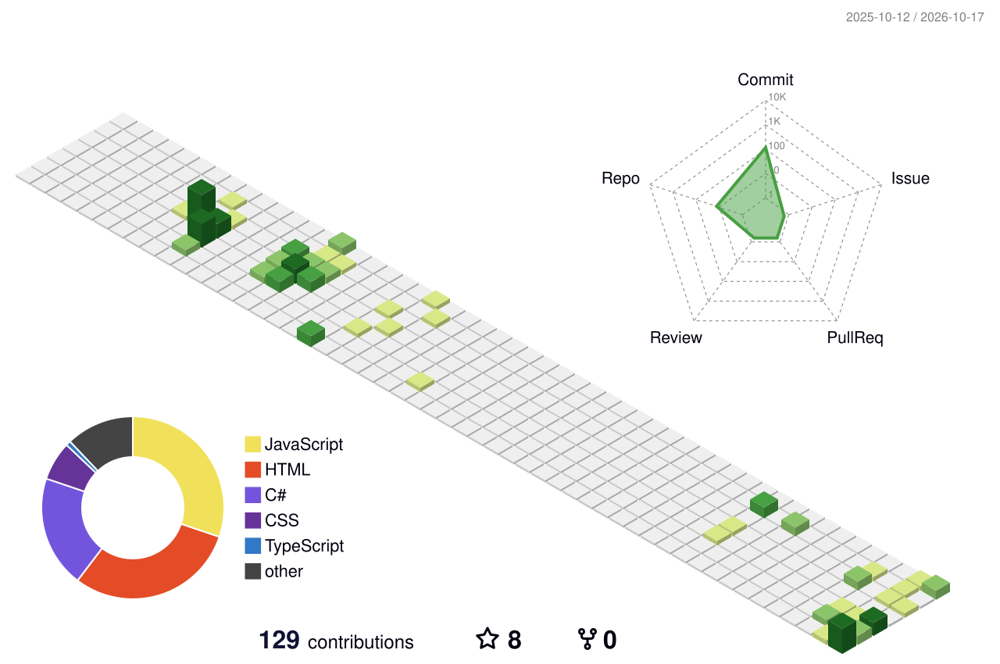

  

 <h1 align="center">✨ Hey there, I'm Gül Karataş! 👋</h1>
<h3 align="center">
  💻 Software Engineer | .NET & React Developer
</h3>

  

---

## 🌈 About Me

- 🚀 I'm a Software Engineer passionate about building modern applications.
- 💜 Currently working with **.NET** and **React**.
- 🧩 I enjoy turning complex problems into clean, user-friendly solutions.
- 🌱 Always learning, experimenting, and building something new.
- 💌 Reach me at **[glserenkarts@gmail.com](mailto:glserenkarts@gmail.com)**

 

---

## 🛠️ Tech Universe

  

---

## 📊 My GitHub Universe

  
  

  

---
<!-- 3D Contribution Calendar -->

  

  <i>Every contribution is another block in my developer journey! 🧱✨</i>

<!-- Contribution Snake -->

  

---

## 🌐 Let's Connect!

  
  
  

---

<h3 align="center">💫 "Dream in code. Build with passion. Keep growing." 💫</h3>

